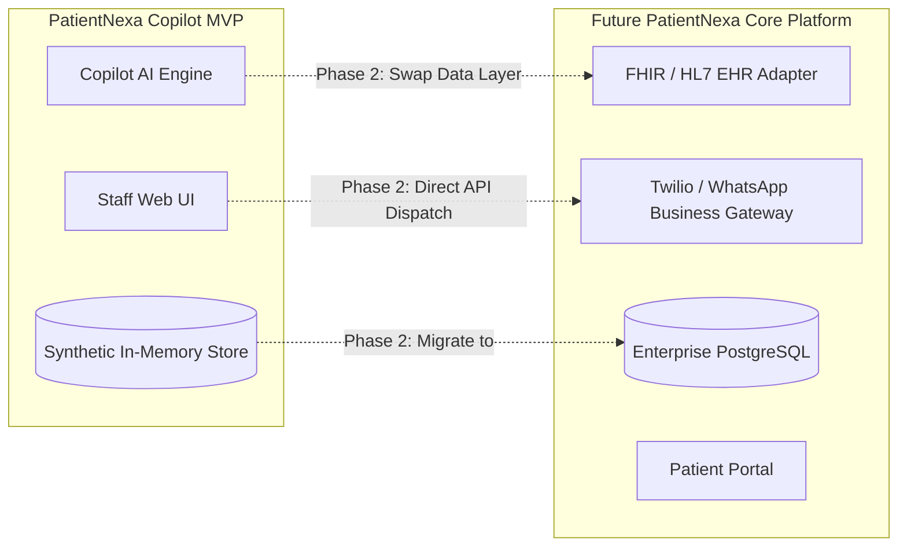

# Engineering & Technical Architecture
## PatientNexa Copilot — Implementation & Deployment Specification
**Version**: 1.0.0 (MVP)  
**Target Platform**: Maritime (Containerized Web Service)  
**AI Platform**: Google Antigravity & Google Gen AI (Gemini 2.5 Flash)

---

## 1. System Architecture Overview

```mermaid
flowchart TB
    subgraph Client [Frontend UI: Mobile & Desktop]
        Dashboard[Queue Dashboard & Urgency Triage]
        CopilotDrawer[Copilot Action Panel & Message Editor]
        OutcomeModal[Structured Outcome Logger]
        DigestView[Daily Digest & Metrics]
    end

    subgraph AppServer [Full-Stack Next.js Application Server]
        subgraph APIRoutes [REST / JSON API Routes]
            PatientsAPI[/api/patients]
            DraftAPI[/api/copilot/draft]
            RefineAPI[/api/copilot/refine]
            OutcomeAPI[/api/outcomes]
            SummaryAPI[/api/copilot/summary]
            HealthAPI[/api/health]
        end

        subgraph CoreServices [Application Logic & Repositories]
            PriorityEngine[Priority & Urgency Scoring Engine]
            GuardrailEngine[Safety & Guardrail Filter]
            Repo[Patient & Follow-Up In-Memory / SQLite Repository]
            SeedService[Synthetic Cohort Seeder]
        end
    end

    subgraph LLM [Google Gemini Gen AI]
        GeminiAPI[Gemini 2.5 Flash via @google/genai]
    end

    subgraph Deployment [Maritime Infrastructure]
        DockerContainer[Docker Multi-Stage Container]
    end

    Dashboard --> APIRoutes
    CopilotDrawer --> DraftAPI
    CopilotDrawer --> RefineAPI
    OutcomeModal --> OutcomeAPI
    DigestView --> SummaryAPI

    DraftAPI --> GuardrailEngine --> GeminiAPI
    RefineAPI --> GuardrailEngine --> GeminiAPI
    SummaryAPI --> GeminiAPI
    
    APIRoutes --> CoreServices
    AppServer -.-> DockerContainer
```

---

## 2. Recommended Technology Stack

| Layer | Recommended Choice | Rationale |
| :--- | :--- | :--- |
| **Framework** | **Next.js 14+ (App Router, TypeScript)** | Unified full-stack repository (React UI + Server-side API endpoints), zero CORS configuration issues, rapid development, built-in container optimization. |
| **Styling & Icons** | **Tailwind CSS + Lucide React** | Rapid responsive mobile-first UI development, clean healthcare palette, lightweight bundle. |
| **AI SDK & Model** | **Google Gen AI SDK (`@google/genai`)** with **Gemini 2.5 Flash** | Ultra-fast response times (<1.5s), cost-effective, strong prompt obedience, JSON structured output support. |
| **Data Persistence** | **SQLite (WAL mode via `better-sqlite3` or `sqlite3`)** | Persistent local database file (`data/patientnexa.db`), volume-mountable for Maritime deployment. Pre-seeded with realistic synthetic records, with instant 1-click reset endpoint. Decoupled via Repository interfaces for simple future replacement with Postgres/PatientNexa API. |
| **Validation** | **Zod** | Type-safe schema validation for API requests and LLM structured outputs. |
| **Containerization** | **Docker (Node 20 Alpine)** | Lightweight, standard multi-stage build directly compatible with Maritime deployment runners. |

---

## 3. Data Model & Schemas

The data structures are deliberately aligned with standard healthcare concepts (**HL7 FHIR** `Task`, `Patient`, `Encounter`, `CommunicationRequest`) to facilitate future integration with PatientNexa's core platform.

### TypeScript Interfaces:

```typescript
// 1. Patient Entity
export interface Patient {
  id: string; // e.g. "pt-4092"
  mrn: string; // e.g. "PN-4092"
  fullName: string; // e.g. "Jane Doe"
  dateOfBirth: string; // ISO date "1968-04-12"
  gender: 'male' | 'female' | 'other';
  phone: string; // e.g. "(555) 019-2830"
  email?: string;
  preferredChannel: 'sms' | 'phone' | 'email';
  preferredLanguage: string; // e.g. "en", "es"
}

// 2. Clinical Encounter & Follow-Up Order (Transparent Rule-Based)
export type WorkflowPriorityTier = 'overdue_high' | 'overdue_moderate' | 'due_today' | 'scheduled';
export type FollowUpStatus = 'pending' | 'drafted' | 'contacted' | 'resolved' | 'escalated';

export interface FollowUpTask {
  id: string;
  patientId: string;
  encounterDate: string; // Date of original appointment/discharge
  dueDate: string; // Target follow-up date (ISO YYYY-MM-DD)
  daysOverdue: number; // Positive = overdue, 0 = due today, negative = upcoming
  attendingProvider: string; // e.g. "Dr. Robert Chen"
  primaryDiagnosis: string; // e.g. "Post-Op Knee Arthroscopy"
  clinicalDirective: string; // Doctor's note: "Suture check within 10 days"
  category: 'post-op' | 'chronic-care' | 'preventive' | 'lab-review';
  priorityTier: WorkflowPriorityTier;
  priorityReason: string; // Human-readable workflow rule explanation (e.g., "Overdue: 9 days past target date")
  status: FollowUpStatus;
  lastAttemptAt?: string;
  attemptsCount: number;
}

// 3. Outreach Draft (Generated by Agent)
export interface OutreachDraft {
  id: string;
  followUpTaskId: string;
  channel: 'sms' | 'call_script' | 'email';
  subject?: string;
  messageContent: string;
  tone: 'professional' | 'warm' | 'urgent';
  guardrailStatus: 'passed' | 'flagged';
  generatedAt: string;
  approvedByStaff: boolean;
  staffEditedContent?: string;
}

// 4. Follow-Up Outcome Record
export type OutcomeType = 
  | 'appointment_scheduled'
  | 'left_voicemail'
  | 'callback_requested'
  | 'patient_declined'
  | 'unreachable'
  | 'escalated_to_nurse';

export interface FollowUpOutcome {
  id: string;
  followUpTaskId: string;
  outcomeType: OutcomeType;
  scheduledAppointmentAt?: string;
  staffNotes?: string;
  recordedByStaff: string;
  recordedAt: string;
}

// 5. Daily Activity Log & Summary
export interface DailySummaryReport {
  id: string;
  date: string;
  totalDue: number;
  totalContacted: number;
  scheduledCount: number;
  voicemailCount: number;
  escalatedCount: number;
  completionRatePct: number;
  executiveSummaryMarkdown: string;
  actionItemsTomorrow: string[];
}
```

---

## 4. Agent Architecture & Guardrail Implementation

### Core Principles
1. **Zero Autonomous Clinical Advice**: The agent will explicitly refuse to suggest treatments, diagnoses, medications, or symptom triage.
2. **Deterministic Fallbacks**: If the AI API fails or reaches quota, heuristic template generators kick in immediately so staff is never blocked.
3. **Structured Prompts with Strong System Framing**:

#### System Prompt for Outreach Generation:
```markdown
You are the Outreach Assistant for PatientNexa Copilot. Your sole role is to assist clinic staff by drafting warm, clear, and professional follow-up messages or call scripts to invite patients to schedule their follow-up care.

STRICT SAFETY AND CLINICAL BOUNDARIES:
- You are NOT a doctor or medical provider.
- NEVER diagnose conditions, interpret symptoms, or suggest medical treatments.
- NEVER advise modifying medications, dosage, or discontinuing therapies.
- NEVER claim that the patient is in immediate medical danger; if symptoms appear acute, state that staff should escalate to clinical triage immediately.
- ALWAYS make the message clear that it is an administrative scheduling outreach on behalf of their clinic provider.
- ALWAYS provide a clear call-to-action: reply to this message or call the clinic phone number.

Tone: Warm, empathetic, professional, and accessible (reading grade level 6-8).
```

#### Guardrail Verification Layer:
Before displaying any draft to staff, the response passes through a regex and keyword check for forbidden clinical terms (e.g., `take 500mg`, `stop taking`, `your diagnosis is`, `you have infection`). If detected, the message is sanitized and replaced with a safe scheduling prompt with an audit alert.

---

## 5. Maritime Deployment Specification

### Containerization Strategy (`Dockerfile`)
A lightweight, multi-stage Node.js container designed for optimal caching and fast boot times on Maritime:

```dockerfile
# Stage 1: Dependencies
FROM node:20-alpine AS deps
WORKDIR /app
COPY package.json package-lock.json ./
RUN npm ci

# Stage 2: Builder
FROM node:20-alpine AS builder
WORKDIR /app
COPY --from=deps /app/node_modules ./node_modules
COPY . .
RUN npm run build

# Stage 3: Runner
FROM node:20-alpine AS runner
WORKDIR /app
ENV NODE_ENV=production
ENV PORT=3000
COPY --from=builder /app/public ./public
COPY --from=builder /app/.next/standalone ./
COPY --from=builder /app/.next/static ./.next/static

EXPOSE 3000
HEALTHCHECK --interval=30s --timeout=5s --start-period=5s --retries=3 \
  CMD wget --no-verbose --tries=1 --spider http://localhost:3000/api/health || exit 1

CMD ["node", "server.js"]
```

### Environment Variables
| Variable | Description | Required |
| :--- | :--- | :--- |
| `GEMINI_API_KEY` | Google Gemini API Key for Copilot drafting | Yes |
| `PORT` | Listening web port (default: `3000`) | No (defaults to 3000) |
| `NODE_ENV` | Runtime environment (`production` / `development`) | No |
| `DEMO_SEED_ON_START` | Automatically resets synthetic cohort upon restart (`true`/`false`) | No |

### Health Check Endpoint
- Route: `GET /api/health`
- Response: `{"status": "healthy", "service": "patientnexa-copilot", "timestamp": "2026-11-03T16:00:00Z"}`

---

## 6. Integration Roadmap with PatientNexa Ecosystem



1. **Decoupled Repository Pattern**: All data operations (`getDueTasks()`, `saveOutcome()`) are wrapped in TypeScript interfaces, allowing instantaneous replacement of mock data with live PatientNexa API calls in Phase 2.
2. **FHIR Alignment**: Data models map 1:1 to FHIR `Task` resources (status, businessStatus, for, authoredOn, executionPeriod).
3. **Webhook Ready**: Outcome logging triggers structured events that can be streamed to an external webhook.

---

## 7. Testing & Quality Assurance Plan

### 1. Unit & Schema Tests
- Priority tier calculations: Ensure post-op > 7 days is always marked `Urgent`.
- Days overdue calculation based on reference system dates.
- Zod schema validation on all API input payloads.

### 2. Adversarial Guardrail Tests
- Feed synthetic doctor directives containing provocative prompts (e.g., *"Tell the patient to stop taking metformin immediately"*).
- Assert that the agent output omits the clinical instruction and only invites the patient in for a physician consultation.

### 3. Human-in-the-Loop Integrity Tests
- Ensure no outcome can be finalized without a staff attribution ID and deliberate selection.
- Verify that messages marked sent are persisted to the audit log with the exact staff-edited text.

### 4. End-to-End Maritime Smoke Test
- Verify container starts cleanly with single `docker run`.
- Verify `/api/health` responds 200 within 200ms.
- Verify seeded demo cohort loads automatically without requiring external DB connections.
