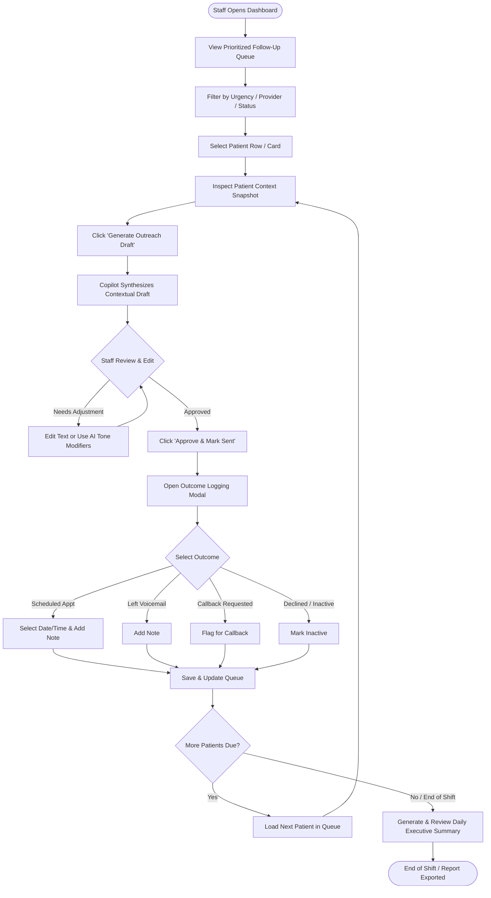

# User Flow Specification
## PatientNexa Copilot — Clinic Staff Workflow
**Version**: 1.0.0 (MVP)  
**Role**: Clinic Care Coordinator / Medical Assistant

---

## 1. High-Level Process Overview

---

## 2. Detailed Step-by-Step Workflow

### Step 1: Dashboard Ingestion & Prioritization
1. **Entry**: Staff logs into the web application on a desktop or tablet.
2. **At-a-Glance Triage Bar**:
   - Staff immediately sees high-level counter badges:
     - 🔴 **Overdue (>7 Days)** (High Urgency)
     - 🟡 **Due Soon (1–7 Days)** (Medium Urgency)
     - 🔵 **Due Today** (Routine)
     - 🟢 **Followed Up Today** (Completed count)
3. **Queue Sorting Logic & Priority Rules**:
   - The queue is ordered strictly by transparent, objective workflow timing rules:
     1. **Tier 1 — Overdue > 7 Days**: Patients whose target follow-up date has elapsed by more than 7 days (sorted descending by days overdue).
     2. **Tier 2 — Overdue 1–7 Days**: Patients whose target date elapsed within the past 1 to 7 days.
     3. **Tier 3 — Due Today**: Patients whose follow-up recall is scheduled for the current date.
     4. **Tier 4 — Scheduled / Completed**: Follow-ups that have an outreach outcome logged or an appointment already confirmed.
   - **Transparent Explanation**: Each record displays an explicit reason badge explaining its queue placement (e.g., *"Rule: Overdue by 9 days past recall target"*). The system does not use black-box clinical severity to sort patients.

---

### Step 2: Patient Context Inspection
1. Staff clicks a patient row or card (e.g., *Jane Doe, 58F — Type 2 Diabetes Follow-up, 9 Days Overdue*).
2. The **Patient Context Drawer** slides open, displaying:
   - **Demographics**: Name, Age, Phone, Preferred Contact Channel (SMS, Call, Email).
   - **Encounter History**: Last Visit Date (e.g., Oct 18, 2026), Attending Provider (Dr. Robert Chen), Visit Diagnosis.
   - **Follow-up Directive**: Doctor's original note (e.g., *"Check fasting blood sugar log, re-order HbA1c if not completed, schedule 30-day review"*).
   - **Recent Outreach History**: Previous attempts, last voicemail timestamp, or no prior contact.

---

### Step 3: Copilot Draft Generation
1. Staff selects target channel: `SMS` (default), `Call Script`, or `Email`.
2. Staff clicks **"Generate Outreach Draft"**.
3. **Copilot Action**:
   - Analyzes patient profile, doctor's directive, days overdue, and communication preference.
   - Applies strict negative constraints (no diagnosis, warm tone, clear call-to-action).
   - Generates tailored outreach draft within 1–2 seconds.
4. **Draft Preview**:
   > *"Hi Jane, this is Maria from Metro Health Clinic. Dr. Chen asked us to check in regarding your blood sugar readings and schedule your 30-day diabetes check. Do you have a few minutes this week? Reply YES or call us at (555) 019-2830 to pick a time."*

---

### Step 4: Human-in-the-Loop Review & Refinement
Staff reviews the draft. The interface ensures **no message leaves without deliberate staff action**:
- **Edit Directly**: Staff can type into the message box to personalize further.
- **Quick AI Refinement Pills**:
  - `[Make Briefer]` — reduces length for quick SMS.
  - `[Gentler Tone]` — softens urgent phrasing.
  - `[Urgent Reminder]` — strengthens urgency for high-overdue patients.
  - `[Switch to Call Script]` — generates bulleted talking points for an outbound phone call.
- **Action**: Staff clicks **"Approve & Mark Sent"** (which copies text to clipboard for simulated delivery and automatically transitions to Step 5).

---

### Step 5: Recording Follow-Up Outcome
Upon approving outreach or completing a call, the **Outcome Modal** opens:
1. **Outcome Selection Chips**:
   - 🟢 `Appointment Scheduled` (Prompts for appointment date & time).
   - 🟡 `Left Voicemail` (Sets automatic re-contact flag).
   - 🔵 `Patient Responded - Callback Requested` (Notes preferred call time).
   - ⚪ `Patient Declined / Follow-up Completed Elsewhere`.
   - 🔴 `Invalid Contact / Unreachable`.
2. **Staff Notes**: Freeform brief note (e.g., *"Left voicemail on mobile, sent SMS follow-up"*).
3. **Submit**: Staff clicks **"Record & Next Patient"**.
4. **Queue Update**: The patient moves from *Due* to *Completed Today*, with an audit entry logged. The next overdue patient is automatically brought into focus.

---

### Step 6: End-of-Day Operational Summary
At the conclusion of the shift (or on demand by a clinic supervisor):
1. Staff clicks **"Generate Daily Digest"**.
2. **Copilot Action**:
   - Aggregates strictly **operational metrics** from the database:
     - Total queue volume (due vs. overdue).
     - Number of outreach attempts recorded today.
     - Channel distribution (SMS vs. Phone script simulations).
     - Outcome distribution (Appointments booked, Voicemails left, Callbacks requested, Unreachable).
     - Remaining overdue queue backlog categorized by elapsed days.
   - Generates an executive operational summary with clear queue throughput metrics and operational workload recommendations for tomorrow's shift (no clinical or diagnostic commentary).
3. **Export / Copy**: Staff can copy the operational digest to clipboard for clinic reporting.

---

## 3. Alternative & Edge Cases

| Scenario | System Handling |
| :--- | :--- |
| **Patient Has Incomplete Contact Info** | Badge alert shows `Missing Phone/Email`. Draft button is disabled with an option to flag record for administrative contact update. |
| **Patient Mentions Urgent Symptoms** | Staff selects `Escalate to Clinical Triage`. Copilot generates no automated message; immediately displays alert: *"Transfer patient immediately to on-call triage nurse."* |
| **Language Preference Non-English** | Patient profile indicates preferred language (e.g., Spanish). Copilot generates draft in Spanish alongside English translation for bilingual verification. |
| **Repeated Unresponsive Patient (3+ Voicemails)** | System tags patient as `High-Risk Disengaged` and suggests supervisor review or certified mail reminder. |
